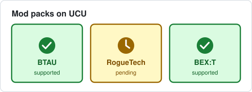
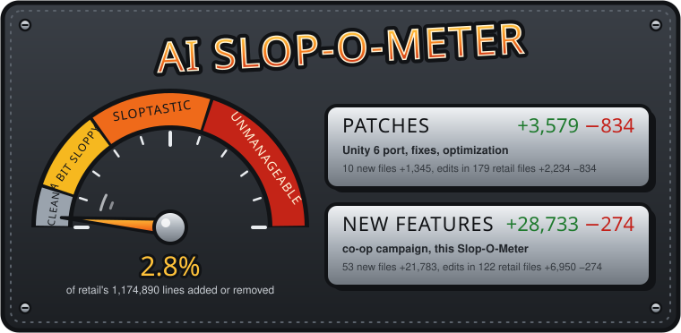

# BattleTech: Unofficial Community Update (UCU)

A (lowercase h) harebrained scheme to port (uppercase) Harebrained Schemes' [*BATTLETECH*](https://www.paradoxinteractive.com/games/battletech) (Unity 2018.4) and all DLC to Unity 6. It adds campaign/career co-op, faster loading, several bugfixes, and an attempt to re-enable combat saves in the big modpacks using on-the-fly adaptations to numerous mods that complicate combat saves. Retail release (Steam or GOG) is required to run it.

**[btucu.org](https://btucu.org)**

## Contents

- [Disclaimers](#disclaimers)
- [Support and Contact](#support-and-contact)
- [Current Release](#current-release)
- [Mission and Scope](#mission-and-scope)
- [Linux and MacOS](#linux-and-macos)
- [What's different from the 2018 retail game (and what isn't)](#whats-different-from-the-2018-retail-game-and-what-isnt)
- [Installing and Running BattleTech: Unofficial Community Update](#installing-and-running-battletech-unofficial-community-update)
- [Mod packs on UCU](#mod-packs-on-ucu)
- [For mod authors](#for-mod-authors)
- [Who I am, and why this project](#who-i-am-and-why-this-project) ([A note on AI](#a-note-on-ai))
- [Project Status](#project-status)
- [Known Issues](#known-issues) and [Known Issues (Modders)](#known-issues-modders)
- [Visuals and lighting](#visuals-and-lighting)
- [Roadmap](#roadmap)
- [Rights and Licensing](#rights-and-licensing)
- [Credits](#credits)

## Disclaimers

This project is a personal, non-commercial effort and is not affiliated with Paradox Interactive or Harebrained Schemes. It operates with permission from Paradox Interactive under their User Generated Content policy, but is not endorsed or supported by Paradox and they are not responsible for modified installs of their product.

**This is a beta, work-in-progress release.** It is maintained by volunteers. Please be patient.

## Support and Contact

**DOWNLOAD**: [releases.btucu.org](https://releases.btucu.org)

**DISCORD**: [discord.btucu.org](https://discord.btucu.org)

**BUGS**: [issues.btucu.org](https://issues.btucu.org) (the Issues tab on our GitHub repository). Create an issue and select the 'Bug report' template, which will tell you where to find your logs. The launcher's *Tools* tab also has a *Collect bug report* button that zips the game's and your mods' logs into one file, ready to attach. For very large logs, use a Google Drive link.

**CONTACT**: info@btucu.org

## Current Release

**Version 2.2.0-3B** (more simply: UCU Beta 3). ([Release Notes](CHANGELOG.md)). Version definitions have to stick to the retail numbering system, but we assign our own meaning to it:

- **2**: Major release: 2.0 is defined as Unity 6-built feature parity with retail and its DLC along with bugfixes, optimizations, and the multiplayer changes below.
- **2**: Minor release with new features or requirements, non-breaking changes backwards compatible within the major release line. A new minor release should indicate a significant fix or new feature.
- **0**: Patchlevel: Bugfixes or minor corrections to the previous minor release.
- **3B**: Simplified release indicator: (A)lpha/(B)eta/(R)elease and the number ('Beta 3' in this example)

The initial 2.0.0A line represented the development cycle from April 2026 to November 2026. Beta 1 was released publicly on November 13, 2026.

## Mission and Scope

Since 'custodian' already has a specific meaning to Paradox Interactive, we can't use that word, but it's the correct word; so instead we'll use 'stewards.' It is our feeling that HBS did a fine job with BATTLETECH and that, for business reasons beyond our understanding, things just didn't work out in such a way that this title could get something like Stellaris' [Custodian Team](https://forum.paradoxplaza.com/forum/developer-diary/stellaris-dev-diary-214-announcing-the-custodians-initiative-and-the-free-lem-update.1477655/) -- but that a bit of polish and some multiplayer love could reinvigorate the project and bring people (and sales) to a title that deserves both. 

We are not game designers and we are not here to impose our vision upon BATTLETECH. That's what mods are for, and we don't make mods. We support the people who do.

## Linux and MacOS

Linux (Proton) is ready for testing. If you try it on Linux or a Steam Deck, please tell us how it went through the Issues link. We are trying to determine whether there is community interest in a native Linux install, or if Proton is sufficient. Submit feedback [here](https://github.com/BATTLETECH-Unofficial-Community-Update/BattleTech-UCU/issues/23).

MacOS is harder for two reasons:

- I have no Mac hardware available for it, so we would depend on somebody in the community who does coming on board, or my getting access to a gaming Mac
- We'd be limited to Rosetta/x86 builds because that's what HBS released, and the commercial binaries required by the game (WWise for audio, Bink for video) did not include Apple native silicon versions. We cannot include non-commercial versions on our own, so PDX would have to acquire these and make them available in order for an Apple native edition to be contemplated (much less built). But if they do, we'll tackle it!

## What's different from the 2018 retail game (and what isn't)

- **Campaign/Career multiplayer.** Retail multiplayer is skirmish-only and relied on multiplayer servers long since sunset (without mods). In 2.0, career and campaign mode support the host inviting up to three other players and assigning permissions for each guest (mech bay, store, hiring, barracks, etc). Everyone sees the Argo, and each player controls the 'Mechs assigned to them. On a mission with fewer 'Mechs than players, anyone not assigned to a 'mech is an observer.
- **Faster loading.** A career save loads in about 17 seconds, down from 29 to 36 in our tests. A heavily modded save loads about a fifth faster.
- **Retail bugs fixed.** Including multiplayer deadlocks, mortar strikes that lost their targets or fired twice on other players' screens, and more.
- **Direct3D 12 is available.** This is a course for future development: D3D12 offers no performance or visual benefit for players (yet). Pick it in the launcher's *Settings* tab, or start the game with `-force-d3d12`. 
- **Mods still work.** ModTek and Harmony mods run with no rebuild. A BattleTech Advanced career has been played through a contract, salvage, and a save and reload, and BattleTech Extended starts a battle, but additional testing is required.
- **Content is unchanged.** If we didn't have to change something to make it work in Unity 6 or with multiplayer, we didn't, other than bugfixes and optimizations.
- **Paradox Online Services.** Paradox accounts work as in retail. Some analysis telemetry (app launch, hardware info) is sent to Paradox in retail but some of it was being rejected. We kept what was being accepted.

See the [CHANGELOG](CHANGELOG.md) for the full list.

2.0 is backward-compatible with retail saves (unless the save shim is enabled for modded games). Multiplayer doesn't connect to retail 1.9.1 players. 

## Installing and Running BattleTech: Unofficial Community Update

Releases are packaged into a launcher which has several layers of validation (so you must be online for the install):

- The installer validates that you own Battletech (retail) through either Steam or GOG and issues a BT-UCU key based on that validation. That is used to download and decrypt the update. This happens automatically when you run the launcher.
- Running the installed game validates that you own it on Steam (and multiplayer requires separate copies -- you can run the game from a shared family library, but only one player in any session can use that copy). The GOG version runs through GOG Galaxy.
- GOG installs support GOG Galaxy and GOG achievements. If you add DLC after installing, run the installer again.

The downside to all this validation is that you end up with larger install sizes, although not as large as the first few releases; we use hard links to pull in the retail files that UCU needs whenever possible, but there is no way around some copy bloat unless Paradox wants to adopt us, and we're not holding our breath!

Updates to BT-UCU will update the installed folder in place. To uninstall, simply delete the folder. 

## Mod packs on UCU

From 2.1.0-2B, UCU can run mods through ModTek. The big mod packs have their own installers, which need retail BATTLETECH 1.9.1 and won't install onto UCU, so you install a pack on retail as usual and then link it across from UCU's launcher.

UCU supports BattleTech Advanced (BTAU) and BattleTech Extended: Tactics (BEX:T) and both have had a surface-level of testing in that they load into the Argo and combat without errors. RogueTech support is pending: it loads part of the way on UCU, but its own launcher is required to run it (see the table). At this time, if you encounter an issue with any of the modpacks, report it here rather than to the modpack maintainers, unless you can reproduce the same issue without UCU.

Here is where each pack stands today (to the best of our knowledge -- please report an issue if you find otherwise!)

| Pack | Known compatibility level | What we have seen |
|---|---|---|
| [BattleTech Advanced (BTA, also called BTAU)](https://www.bta3062.com/index.php?title=Main_Page) 20.3 | **Good** | On Windows and Proton under Linux, it loads, and users have played a career through a contract, salvage and a save and reload.  |
| [BattleTech Extended (BEX:T)](https://battletech-extended-3025.fandom.com/wiki/Getting_Started) | **Good** | It loads and starts a battle, as of 2.2.0-3B.
| [RogueTech](https://roguetech.fandom.com/wiki/Roguetech_Wiki) | **Pending** | One of its mods, CustomUnitSpawn, failed to start and, as of 2.2.0-3B, now does. However, RogueTech's core then refuses to run, because RogueTech must be started through its own launcher, and that launcher needs the retail `BattleTech.exe`. The RogueTech team is reviewing options. |

Any ModTek pack should work the same way. If you try one, please tell us how it went through the Issues link, whether it worked or not.

### Linking a pack (the BTA steps; we expect other packs to be the same)

1. **Install BTA on your retail game** the way its authors describe, and start it once.
2. **Install UCU with mod support on.** The installer has a *Mod support* box under "Install to", ticked by default. It puts the mod loader beside `BattleTech.exe`; without a `Mods` folder, UCU starts exactly as it does unmodded. Start UCU once.
3. **Link BTA.** Open UCU's launcher (`BattleTech UCU Launcher.exe` in your UCU install) and use its *Mods* tab, or open the `ModSupport` folder inside your UCU install and double-click `Link BTA.cmd`. It finds both installs in your Steam libraries and asks about any it can't find (or drag your BTA folder onto it). It links each of BTA's mod folders (plus `Mods_sfx` and `Music`) into UCU, which takes seconds and no disk space, and copies your BTA saves. Both installs must be on NTFS drives in this PC.
4. **Start UCU as usual.** The first start is slow while ModTek builds its cache.

Good to know:

- **Both games share the linked mods.** Mods write into their own folders while the game runs, so UCU writes mod logs and settings into your BTA install, and turning a mod off in one game turns it off in the other.
- **After a BTA update**, UCU picks it up by itself. If the pack added or removed a mod, run Link BTA again. Add mods to BTA, not to UCU.
- **To keep the games apart**, double-click `Link BTA (copy).cmd` instead. It copies the mods, so your BTA install is only read, but UCU's drive needs about 20 GB free, and you run it again after each BTA update.
- **Saves:** a BTA career carries over. On a re-run, a save you made in UCU is kept, not replaced by an older BTA one. To skip saves, run `Link BTA.cmd -NoSaves`.
- **Leave a mod out:** `Link BTA.cmd -Skip ModName`.
- **Back to unmodded UCU:** `Link BTA.cmd -Unlink` removes the linked or copied mods. Your saves and your BTA install stay.
- **Mods didn't load?** Open `BattleTechPortBootstrap.log` beside `BattleTech.exe` and attach it to your bug report with `Player.log`. A good run ends with `done|retargeted=5`.
- Link BTA won't run while UCU is open, if it finds a `Mods` folder it didn't make, if either install isn't on an NTFS drive in this PC (use the copy launcher then), or, when copying, if the drive is too full. It writes nothing until those checks pass.
- **On Linux or a Steam Deck**, open a terminal in the `ModSupport` folder and run `bash link-bta.sh` instead (add `--copy` to copy). Then add `WINEDLLOVERRIDES="winhttp=n,b" %command%` to UCU's Steam launch options, or Proton won't start the mod loader. BTA ships ModTek 4.4.x, whose MonoMod could break the game's code under Proton; UCU's mod loader now applies MonoMod's own fix. On our Linux test PC, BTA 20.3 on UCU loads and plays a skirmish under Proton. A BTA career and saves haven't been tested under Proton yet.

## For mod authors

UCU runs stock ModTek mods, and a few of them need help from UCU's mod loader. [What UCU changes for each mod](docs/mods/README.md) is the place to start. It lists every such change, mod by mod, in a short note for each mod (ModTek, CustomUnits, CustomAmmoCategories, MissionControl, IRTweaks, MechEngineer and others): what broke, what UCU does about it, and what the mod could change so it needs no help. It also covers:

- **The adapters themselves.** They are UCU's own Harmony patches, applied in memory only when their mod loads, with the source in [`tools/mod-bootstrap/`](tools/mod-bootstrap/). Nothing on disk, in your mods or in the game, is changed.
- **Fixes in UCU's game code that help mods.** For example, the multiplayer content check now lets two players with the same mod pack join each other, and a retail bug that could leave a modded combat load running forever is fixed. These are described in words, because that code isn't published.
- **Co-op with mods**, for the mods that need help staying in step between players.
- **Combat saves.** Several adapters exist for the experimental in-mission saves option (launcher → *Mods*, off by default). A separate guide, [Combat saves: notes for mod authors](docs/mod-authors-combat-saves.md), explains why mod saves fail and what a mod can do so it saves and loads correctly without any help.

## Who I am, and why this project

This project began as a thought experiment of 'I wonder whether this is possible' and turned into a full-blown update of the game to Unity 6.

I'm InternetDadCo, the founder and principal architect at a software company that does not, on a typical day, involve giant robots. In the Spring of 2026, we were in the midst of the transformation of the software sector from 'sometimes AI assisted' to 'AI-driven, human supervised' -- but we're all aware that this transition is not without its obstacles, and I wanted to experiment on my own time with different models and harnesses to learn their strengths, weaknesses, and limitations. 

At the same time, my son was getting into the 2018 Battletech game, and he wanted to know why we couldn't play the campaign together, since multiplayer was only supported in skirmish mode. I knew very little about Unity -- the little game development experience I had came from MUSHes in the early 2000s -- but I thought it would be a fun exercise to dig into the retail release and see what it would take to give Harebrained's fantastic 2018 game a little 2026 update, since the barrier to doing so these days is a lot lower than it was a year ago.

### A note on AI

The below is a brief statement about AI usage in this project. For more detail, see our [Note on AI](NOTE-ON-AI.md) and if you have specific questions, we will address them there in future revisions.

There is an avalanche of AI slop projects. Built into the DNA of our project's mission is that we retain the discipline and focus to avoid that label. On the one hand, this project represents exactly the kind of effort that wasn't viable before AI; there's not enough money or other incentive for any of the commercial entities concerned to have undertaken it. But just because you can doesn't mean you should. 

Retail's own code is over a million lines.  We didn't want to fix what wasn't broke. 'Patches' counts changes we've made to retail code to bring it forward into Unity 6, fix a bug, or improve performance. New features are limited to multiplayer career/campaign mode.

I am a software developer with more than two decades of experience, but the folks at Harebrained and Paradox have more understanding of how these things work in their pinky fingers than I do. I'm a generalist but not a Unity developer, and I had to develop a rudimentary enough understanding of the Unity engine to know how to direct the AI and to evaluate whether it could achieve parity with a very mature, battle-tested retail release. Progress was very slow at first, but once we were able to get the UI off the ground, the rest followed.

AI made this project possible. AI can also ruin it. That's why we maintain the slop-o-meter and why the majority of our effort goes into bugfixes, fidelity with the original game, and the narrow scope of 'new stuff' that we've accepted. Battletech has a superb modding community and it's the folks over at [BTA](https://www.bta3062.com/) and [RogueTech](https://roguetech.fandom.com/) and elsewhere who keep interest in this title alive. 

Nobody wants new releases with breaking changes or significant alterations to features every couple of days; but we wouldn't be here at all but for AI labor. If you disagree, that's cool, I respect your artisanal cheese-making and butter-churning! But in our house, we had giant robots to blow up and that was only going to happen with some help.

## Project Status

The update is playable and (we hope) most of what's needed now is attention on some of the fiddly bits that a dedicated group of players will find in no time -- especially on career multiplayer. We've tested a lot, and at this point we need to stop and make sure the project has legs: if it does, we'll turn this into a community-driven beta since you all can test a lot better than any harness. What we have done is a lot of comparison and playthroughs to make sure that behavior matches retail and things draw properly.

We've also maintained mod support and loaded BattleTech Advanced and BattleTech Extended: Tactics, but we need the community's help doing playthroughs and testing other mods.

## Known Issues

Places where UCU means to match retail but doesn't quite yet. Deliberate changes are in [CHANGELOG.md](CHANGELOG.md).

- **Ground around large rocks** is about 5% darker than retail's, because the rocks block bounced light without bouncing any of their own.
- **Urban maps:** Metro Green's light probes come out 7-8% brighter than retail's, and the bounce near its highway is warmer.
- **Martian maps** look less red and less saturated than retail's, and their rocks show more contrast. This was measured at different times of day and isn't confirmed yet.
- **Most maps** haven't been compared with retail side by side under the same weather, and decals have been measured only on Central Mountain and Still Valley.
- **Portraits** read slightly darker than retail, mostly on the shaded side of the face, and one preset's hair tips look cyan.
- **Memory in long sessions** ([issue #22](https://github.com/BATTLETECH-Unofficial-Community-Update/BattleTech-UCU/issues/22)): Memory use grows during a long session, about 1.5 GB above the original game after three missions and then about 200 MB per mission (around 9 GB after twelve). The original game also grows as you play. Restarting the game returns the memory. We are still working on it.

## Known Issues (Modders)

Things only someone running or writing mods would see.

- **Log lines without ModTek:** With mod support on and no ModTek installed, `Player.log` shows "Error getting types in assembly ... BattleTechPortBootstrap ... Could not load MonoMod.Core" five times at each start. It's harmless: the original game's own scan of loaded code writes it as an information line, and the game runs normally.

## Visuals and lighting

Most of our effort went into making the game look the way it did in 2018, because that is the hardest part to check. Rules can be tested: give UCU and retail the same inputs and the results must match. Pictures, less so. Skirmish weather is picked at random, clouds drift and the camera pans, so two screenshots only compare fairly on the same map, weather, moment and view, and someone still has to judge which differences matter. We've compared several maps closely, but not all of them in every weather.

Why UCU can look different from retail:

- **Shaders** ship only as compiled code. We rebuilt each one from that code and check it against retail's, but a shader that failed to rebuild or load draws wrong.
- **Bounced light** (realtime GI) had to be baked again. Unity 6 couldn't bake retail's maps with retail's settings, so each map is rebaked from retail's own layout. It comes close to retail but isn't identical. Would you notice if we didn't tell you? Is it an issue? You tell us.
- **Textures and materials:** Unity 6's importer changed defaults that retail relied on for some textures and materials. UCU now uses the 2018 game's own image data for many textures.

Signs of something we should know about:

- pink, magenta or bright cyan surfaces, which mean a shader failed;
- black, see-through or missing surfaces, or missing decals such as road markings, dust or snow;
- a tint retail doesn't have, such as lavender on building fronts;
- an area much darker or brighter than the scene around it, or than the same spot in retail, most often in shade or under cover;
- flickering, shimmering, or shadows that pop.

Small shifts of a few percent in brightness or colour are expected and listed below. If you report something, give the map, the weather and time of day, and a screenshot. A retail screenshot of the same spot in the same weather helps most, and the game's `Player.log` helps too. Visual issues get priority.

## Roadmap

Our priorities:

- **Your feedback.** This has been our pet project for the last seven months; now it's up to you to put the 'UC' in this update.
- **Career and campaign co-op.** Since this is the flagship feature, we'd like to reduce any further barriers to people playing Battletech together!
- **Direct3D 12.** Still very much a 'maybe' but we'll be exploring the possibilities and ramifications.
- **CoreCLR** (long-term) replacing the Mono runtime with CoreCLR in Unity 7 is a big investment but one with significant dividends. 

## Rights and Licensing

The source code for the installer and unlock server is licensed under the MIT License; see [installer/LICENSE](installer/LICENSE). This license does not cover BATTLETECH artwork, trademarks, game content, or the UCU game update.

BATTLETECH and its associated content belong to their respective rights holders. UCU is a non-commercial community project operated under Paradox Interactive’s User Generated Content policy and requires a retail copy of BATTLETECH. See Paradox’s [User Agreement](https://legal.paradoxplaza.com/eula?locale=en) for applicable terms.

## Credits

All of the original assets upon which this project is based come from, and belong to Harebrained Schemes and Paradox Interactive.

Battletech is a registered trademark of Microsoft Gaming and the Topps Company (licensed to Catalyst Game Labs). 

LiAlH4, for gifting a GOG key to the project so we could add GOG support.

[Jaroslav Stehlik](https://github.com/jaroslavstehlik) and other contributors to that project for the SVG Importer.

[NotNull92](https://github.com/NotNull92) for the Hera Unity Agent.

UCU was founded and is presently directed by InternetDadCo.

Finally, to Jack, for the idea and a reason to go to the trouble.